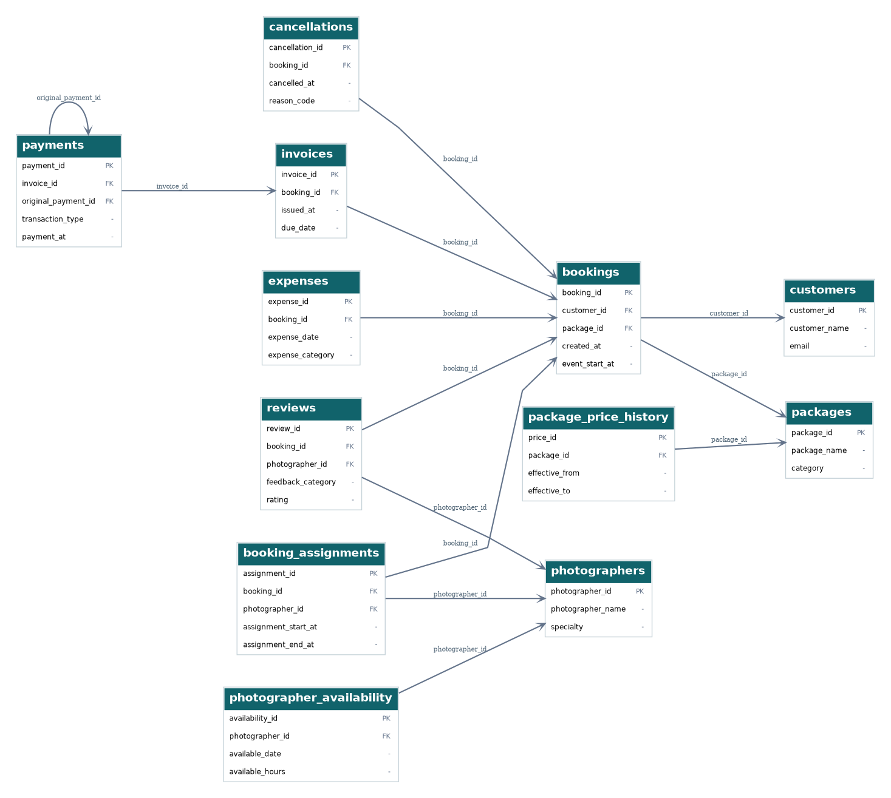
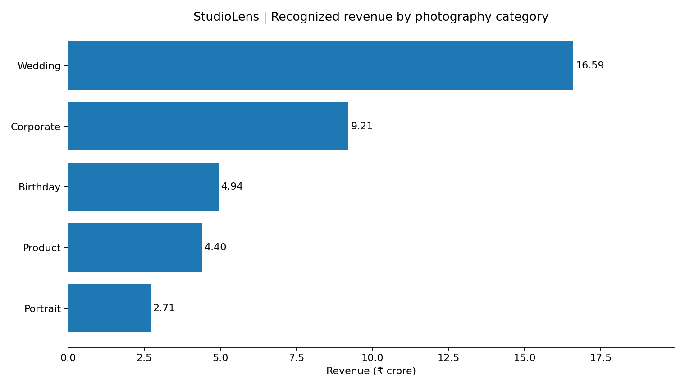
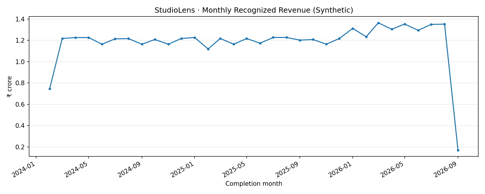

# StudioLens — Photography Studio SQL Analytics

**PostgreSQL · DBeaver · SQL**

I built StudioLens as a SQL practice project based on a fictional photography studio. The idea was to see how customer bookings, packages and payments could be analyzed to answer everyday business questions. I used synthetic data, so none of the findings describe a real company.

## The problem I wanted to solve

A photography studio deals with different types of bookings, customer records, invoices and payments. I wanted to bring this information together to understand which services generate revenue, how bookings are performing and which customers return.

## What I worked on

1. **Planning:** Chose the business questions and a synthetic dataset.
2. **Database design:** Worked with 12 related PostgreSQL tables, primary keys and foreign keys.
3. **Data preparation:** Generated records in my local database and checked missing values, duplicates and relationships. I also practiced basic CRUD on a temporary table.
4. **SQL analysis:** Used joins, grouping, subqueries/CTEs and a few window functions to answer business questions.
5. **Reporting:** Exported CSV summaries, made charts and wrote down the findings.

## Tools and SQL concepts

- **Tools:** PostgreSQL 17, DBeaver, SQL
- **Basic:** `SELECT`, `WHERE`, `ORDER BY`, `INSERT`, `UPDATE`, `DELETE`
- **Intermediate:** `JOIN`, `GROUP BY`, `HAVING`, `CASE`, `COALESCE`, CTEs
- **Advanced examples:** `RANK()` and `LAG()`

This is a personal learning project, not professional employment experience.

## Data

The full dataset in my private PostgreSQL database has **12 tables and 98,573 synthetic records**, including 5,000 customers and 15,000 bookings. The reporting period is January 2024 to October 2026, with a cutoff of November 1, 2026 at midnight Asia/Kolkata.

I have included a small customer sample and summary exports here. I kept the full data generator and the more detailed database scripts privately on my Mac.

## Database design

The `bookings` table connects customers to packages. Related tables help track assignments, invoices, payments, cancellations, reviews and expenses.



- [Conceptual ERD](diagrams/01_erd_business.png)
- [Relational schema](diagrams/02_relational_schema.png)
- [Physical diagram based on initial DDL](diagrams/03_physical_ddl.png)
- [12-table CREATE TABLE script](database/01_create_tables.sql)

The three diagrams above were drawn from the original SQL definitions. They are not exports from the live database; the physical diagram does not include every later migration change.

**Actual database check:** I also connected DbVisualizer to my populated `studiolens_db` database and viewed its **12 tables and 13 foreign-key relationships**. Here is the [real DbVisualizer screenshot](screenshots/01_dbvisualizer_actual_relationship_graph.png). It was captured at 33% zoom, so the larger diagrams above are easier to read. I can replace that screenshot with a full-resolution graph export later.

## SQL examples

I kept the queries in separate files so it is easier to see what each part does.

| File | What I used it for |
|---|---|
| [`database/02_crud_practice.sql`](database/02_crud_practice.sql) | INSERT, SELECT, UPDATE and DELETE practice |
| [`database/03_standalone_sql_demo.sql`](database/03_standalone_sql_demo.sql) | Small runnable demo with joins and rankings |
| [`sql/01_data_quality.sql`](sql/01_data_quality.sql) | Checks for missing values, duplicates and inconsistent text |
| [`sql/02_data_exploration.sql`](sql/02_data_exploration.sql) | Basic filters, counts and grouping |
| [`sql/03_booking_analysis.sql`](sql/03_booking_analysis.sql) | Completed bookings, categories and cancellations |
| [`sql/04_revenue_analysis.sql`](sql/04_revenue_analysis.sql) | Category and monthly revenue |
| [`sql/05_customer_analysis.sql`](sql/05_customer_analysis.sql) | Customers with repeat completed bookings |
| [`sql/06_window_functions.sql`](sql/06_window_functions.sql) | Revenue ranking using RANK and month comparison with LAG |
| [`sql/07_selected_kpis.sql`](sql/07_selected_kpis.sql) | A small set of business KPIs |

Here is one example of joining bookings with packages:

```sql
SELECT p.category,
       COUNT(*) AS total_bookings
FROM public.bookings AS b
JOIN public.packages AS p
  ON b.package_id = p.package_id
GROUP BY p.category
ORDER BY total_bookings DESC;
```

## Findings from the synthetic data

| Metric | Result |
|---|---:|
| Customers | 5,000 |
| Bookings | 15,000 |
| Completed bookings | 11,700 |
| Cancelled bookings | 1,800 |
| Recognized revenue | ₹378,515,300 (about ₹37.85 crore) |
| Net cash collected after refunds | ₹300,689,700 |
| Calculated outstanding receivables | ₹77,825,600 |

Wedding photography had the largest share of modeled revenue, about **43.84%**. Corporate photography was second at about **24.33%**. This points to which categories contribute the most revenue, not necessarily which are most profitable.

The cancelled-booking share was **12% (1,800 / 15,000)**. This is a descriptive percentage, **not** the more detailed 30-day cohort cancellation KPI.

### Revenue by photography category



[View my DBeaver category-revenue query output](screenshots/02_dbeaver_category_revenue_results.png).

### Monthly revenue



I would next look at expenses by category, reasons for cancellation, and whether payment follow-ups affect overdue balances. All of these results come from **simulated data**.

[View my DBeaver refund-validation result (zero issues in three checks)](screenshots/03_dbeaver_refund_integrity_results.png).

More detail: [Business findings](docs/BUSINESS_FINDINGS.md) · [SQL skills](docs/SQL_SKILLS.md)

## How to run

**Try it without my database:** Open PostgreSQL in DBeaver and run [`database/03_standalone_sql_demo.sql`](database/03_standalone_sql_demo.sql) as a complete script. It creates temporary sample tables, inserts fictional records, runs basic and advanced examples, and finishes with `ROLLBACK`. It leaves your existing database unchanged.

**If you have the original populated StudioLens database:** Run the files under `sql/` against the `public` schema. Some reporting queries rely on the two historical reporting views from my private project. I haven't published the complete original synthetic dataset or those view definitions, so the large headline totals **cannot be recreated from this public ZIP alone**.

**Do not** rerun the original 12-table DDL against an existing populated database. Read the [run guide](docs/RUN_GUIDE.md) first.

## What I learned

The biggest thing I learned was that getting a SQL result is not enough. I also need to check if the number makes sense, use the right relationships, and explain what it tells me about the business.
