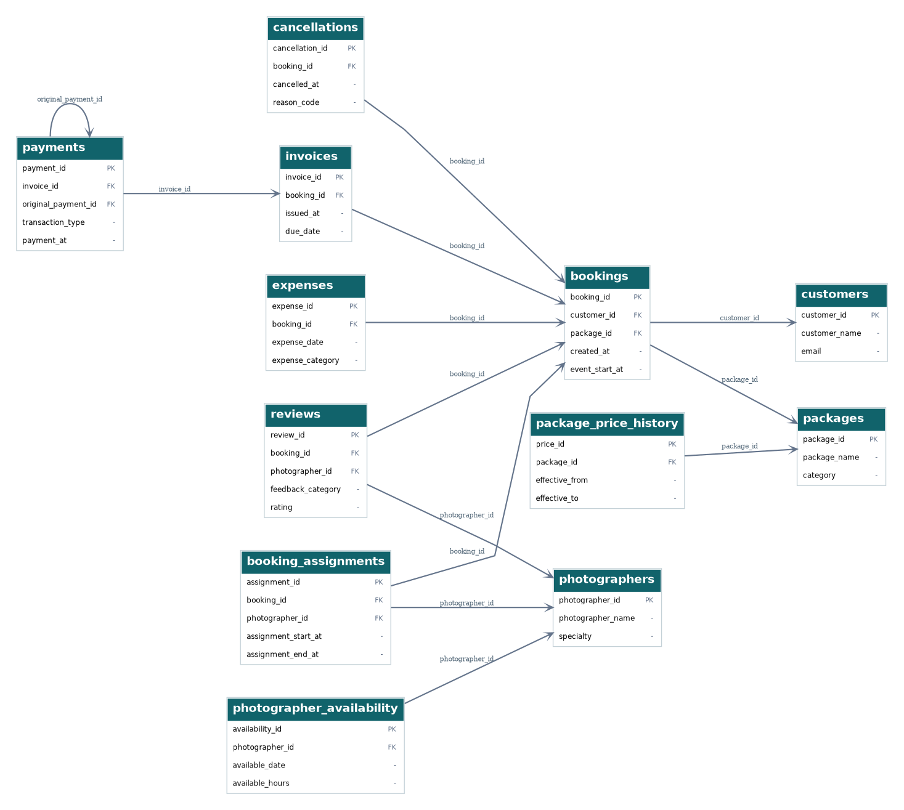
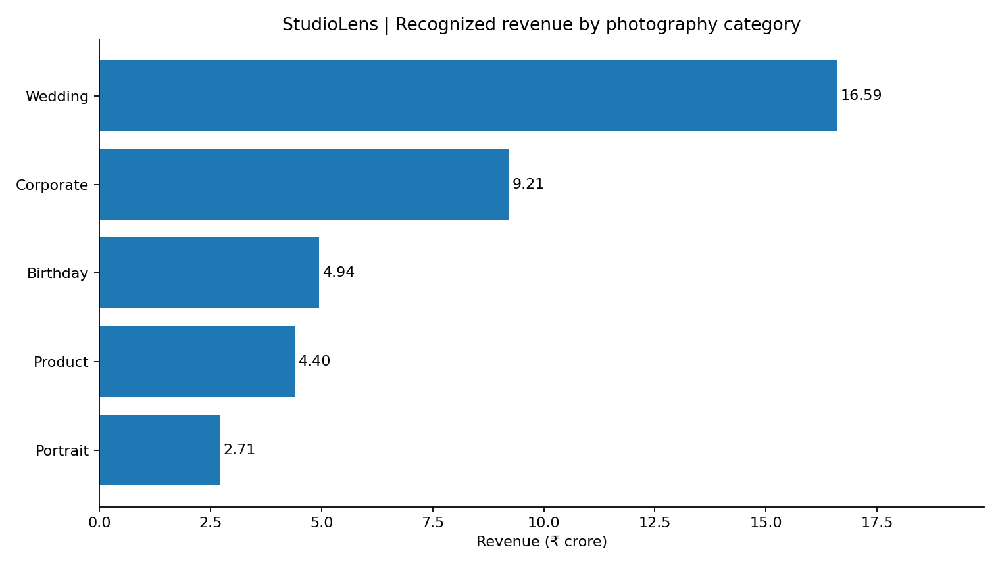
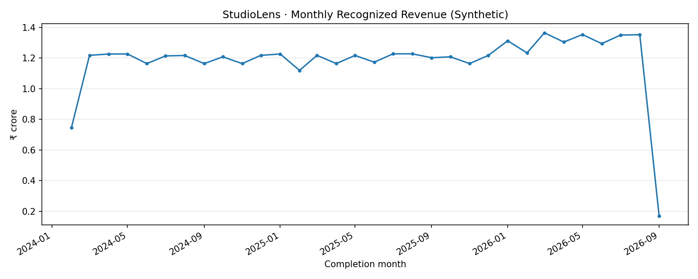

# 📸 StudioLens — Photography Studio Business & Revenue Analytics

### 📊 SQL Data Analytics Portfolio Project

**Tools:** PostgreSQL 17.3 · DBeaver 26.2.4 · DbVisualizer 26.2.5 · SQL  
**Dataset:** Synthetic photography studio operations  
**Analysis period:** January 2024 – October 2026

## 📌 About my project

I built **StudioLens** to practice SQL using a photography studio business scenario. A studio handles customers, bookings, packages, photographers, invoices, payments, cancellations and expenses. I wanted to connect these records and use them to understand how the business was performing.

My main questions were: Which photography services generate the most revenue? How many bookings are completed or cancelled? Do customers come back? And how much of the invoiced revenue has actually been collected?

I used a **synthetic dataset of 98,573 records across 12 PostgreSQL tables**. The data and results are fictional, but the database work and SQL analysis reflect the steps I practiced.

## 🛠️ Software and SQL skills

| Tool or skill | What I used it for |
|---|---|
| **PostgreSQL** | Creating relational tables and storing the data |
| **DBeaver** | Writing, running and checking SQL queries |
| **DbVisualizer** | Examining table relationships in the real database |
| **Basic SQL** | `SELECT`, `WHERE`, `ORDER BY`, `DISTINCT`, `INSERT`, `UPDATE`, `DELETE` |
| **Intermediate SQL** | `JOIN`, `GROUP BY`, `HAVING`, `CASE`, subqueries and CTEs |
| **Advanced SQL** | `RANK()`, `LAG()`, window functions and date-based analysis |
| **CSV and charts** | Summarizing and presenting results |

## 🗂️ 1. Database design

I started by identifying the main parts of the photography studio and designing tables for **customers, bookings, packages, photographers, booking assignments, invoices, payments, expenses, cancellations, reviews, package price history and photographer availability**.

I used **primary keys, foreign keys and database constraints** to connect the information and check its consistency.

### 🧩 Relational database diagram

### 🔍 My actual PostgreSQL relationships in DbVisualizer

The first diagram was drawn from my original SQL schema. The second is a real screenshot of the connected database, showing its **12 tables and 13 foreign-key relationships**. The original diagram does not represent every later database migration.

[See the conceptual ERD](diagrams/01_erd_business.png) · [See the physical schema diagram](diagrams/03_physical_ddl.png)

## 🧹 2. Data preparation and quality checks

I generated and worked with synthetic records, including **5,000 customers**, **15,000 bookings**, **25 photographers** and **20 packages**. Before calculating metrics, I checked for missing values, duplicate identifiers, invalid relationships, inconsistent booking statuses and financial data issues.

I also practiced **CRUD operations** on separate sample records to understand how data is inserted, updated and deleted.

## 💻 3. SQL analysis — basic to advanced

I used **filters and aggregations** to explore the data, **joins** to connect bookings with packages and financial records, and **CTEs** to make more complex queries easier to read.

I then used **`RANK()`** for revenue rankings and **`LAG()`** to compare monthly values. My analysis covered booking volume, completed services, customer activity, category revenue and cash collections.

📂 **My SQL work:** [Data quality](sql/01_data_quality.sql) · [Data exploration](sql/02_data_exploration.sql) · [Booking analysis](sql/03_booking_analysis.sql) · [Revenue analysis](sql/04_revenue_analysis.sql) · [Customer analysis](sql/05_customer_analysis.sql) · [Window functions](sql/06_window_functions.sql) · [Selected KPIs](sql/07_selected_kpis.sql) · [CRUD practice](database/02_crud_practice.sql)

### 🖥️ SQL query results in DBeaver

## 📊 4. Business performance and findings

These are results from the **synthetic StudioLens dataset**, not from a real photography business.

| Metric | Result |
|---|---:|
| Total bookings | **15,000** |
| Completed bookings | **11,700** |
| Cancelled bookings | **1,800** |
| Recognized revenue | **₹37.85 crore** |
| Net cash collected after refunds | **₹30.07 crore** |
| Outstanding receivables | **₹7.78 crore** |

### 💰 Finding 1 — Wedding photography led revenue

**Wedding photography** contributed about **43.84%** of modeled revenue; **corporate photography** followed at about **24.33%**. This helped me identify the highest-revenue services. To decide which services are most profitable, I would also need to compare their expenses.

### 📈 Finding 2 — Monthly revenue needs its own view

I grouped revenue by month and explored changes across the reporting period. Monthly trends can help a studio understand demand patterns and plan staffing, but they need to be interpreted alongside bookings, service mix and expenses.

### ❌ Finding 3 — Some bookings did not go ahead

There were **1,800 cancelled bookings out of 15,000**, a simple **12% cancelled-booking share**. This is a descriptive percentage, **not** the separate 30-day cohort cancellation-rate KPI. I would investigate cancellation reasons and timing before recommending changes.

### 💳 Finding 4 — Revenue is different from cash collected

Recognized revenue was approximately **₹37.85 crore**, while net collected cash was approximately **₹30.07 crore**. The modeled difference of around **₹7.78 crore** was outstanding receivables. This showed me why payment collection and invoiced revenue should be reported separately.

## 🎯 5. What I learned

Working on StudioLens helped me practice the complete flow from **database design → data checks → SQL analysis → KPI reporting → business findings**.

The most important lesson was that a query result is only useful when I understand **what the number represents**, check that the joins and calculations are correct, and explain what it might mean for the business.

## 📁 What I included in this repository

| Folder | Contents |
|---|---|
| [`database/`](database/) | Original schema and CRUD practice |
| [`sql/`](sql/) | Basic, intermediate and advanced SQL analysis |
| [`diagrams/`](diagrams/) | Conceptual, relational and physical schema diagrams |
| [`screenshots/`](screenshots/) | Actual DbVisualizer and DBeaver results |
| [`charts/`](charts/) | Revenue visualizations |
| [`reports/`](reports/) | Exported CSV summaries |
| [`docs/`](docs/) | Business findings and database notes |
| [`data/`](data/) | Small demonstration sample |

**Note:** The complete synthetic database, data-generation work and some historical reporting definitions are kept in my private project. This public repository contains selected SQL files, sample data, diagrams and reporting outputs; it cannot recreate every headline metric from the sample alone.

---

*StudioLens is a personal learning and portfolio project created with synthetic data.*
